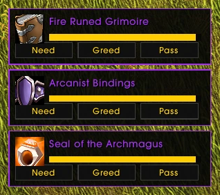

# CleanLoot

Clean loot roll frames for **WoW Forever** (the official Blizzard beta client). Lightweight and standalone.

  
  

## Features

- **Its own roll frames** in place of Blizzard's: item icon with tooltip (**Ctrl+click** to preview, **Shift+click** to link in chat), name and border coloured by quality, timer bar, and **Need / Greed / Pass** (Forever has no Disenchant or Transmog rolls)
- **Live vote counters**: a number on each button for how many players chose it, and on hover the list of players (class coloured, with the roll once the game reveals it) — also on a greyed-out button, which also tells you why it is unavailable
- **"Hasn't rolled yet"**: a small clock with the number of players still deciding; hover for who
- **Big drops**: more rolls than frames? The rest wait in a queue and appear as you answer, with their timers still running. No roll is lost
- **After a `/reload`**, rolls still running are brought back
- **Controller mode** (off by default, made for gamepads and keyboards): select a visible roll and answer Need / Greed / Pass with bindings on keys or controller buttons (set from the options) or slash commands, with an optional inspection tooltip
- **Auto-roll** (nothing is automatic until you make a rule): always Need, Greed or Pass on an item you choose (right-click the button on its roll frame, or add it on the *Auto-roll* page), and optionally one answer for every green, blue, epic or legendary item. A rule only answers when the answer is possible; otherwise the roll stays yours
- **Watchlist**: a list of items you want to be reminded of. When one drops, its roll frame gets a gently pulsing cyan outline, and the note you wrote for it shows on the frame. Nothing is answered for you
- **Master loot**: when the rolls end, everyone in the group gets a *roll result* window for the item: every roll with the player's name, best first, ties flagged. The master looter clicks a name to give that player the item (a small confirmation opens at the mouse), and the group is told in /p (or /ra in a raid): `[CleanLoot] [item] given to Name for roll Greed 44`
- **Blizzard's own roll frames are hidden** (and stop catching clicks). the options bring them back
- **Less chat spam**: the per-roll lines (who selected what, roll values) are filtered out; **who won what** and your loot stay visible. Blizzard's *Loot Rolls* history window keeps everything
- **Winner popup**: when a roll ends, a small card shows who won and with which roll, and always your own roll (rolled, passed or did not answer). Hover it for every roll of the drop; right-click closes it. It stacks downwards or upwards, as you choose. A small **Waiting on rolls** card opens the stack while a roll is still open; hover it for each item with how many players have not rolled, then their names (you included while you have not answered; an option turns it off). It stands in for the roll lines the chat filter hides
- **Loot toast options** (off by default): hide the "You won" banner (all of them, or only for the items the winner popup reports), shrink it, or move the alert banners (*Loot toasts* column of the options)
- **Minimap button**: left-click the loot history, right-click the options window
- **Options window** (`/cll`, which also closes it; or the minimap button's right-click, or *Game Menu → Options → AddOns → CleanLoot*): stacking direction, scale, position lock, Blizzard's frames, chat filter, loot toasts, minimap button, and a tab each for controller mode, auto-roll and the watchlist. It is a window of its own, not a modal game panel: the bags, the Dungeon Journal or the chat can stay open beside it, you can move it, and Esc closes it

## Installation

- **CurseForge / WoW addon manager**: install *CleanLoot* for WoW Forever.
- **Manual**: download the zip from the [releases](https://github.com/hazaswow/CleanLoot/releases) and extract the `CleanLoot` folder into the `Interface/AddOns` folder of your WoW Forever install (the `_forever_` folder). The folder must be named exactly `CleanLoot` and contain `Libs/`.

## Commands

| Command | Effect |
|---|---|
| `/cll` | Open the options window (again: close it) |
| `/cll controller` | Open the controller mode tab of the options window |
| `/cll auto` | Open the auto-roll tab of the options window |
| `/cll auto need` / `greed` / `pass` `[item]` | Always roll that way on an item (shift-click it into the chat line, or give its id) |
| `/cll auto remove [item]` / `/cll auto list` | Forget an item's rule / list the rules |
| `/cll watch` | Open the watchlist tab of the options window |
| `/cll watch [item] [note]` | Highlight an item when it drops, with an optional note (shift-click it into the chat line, or give its id) |
| `/cll watch note [item] <text>` / `remove [item]` / `list` | Change an item's note / forget it / list the watched items |
| `/cll restore` | Bring back rolls still running (automatic at login and `/reload`) |
| `/cll next` / `/cll previous` | Select the next or previous visible roll |
| `/cll inspect` | Toggle the separate inspection tooltip |
| `/cll need` / `/cll greed` / `/cll pass` | Roll on the selected item |
| `/cll sim [n]` | Simulate *n* loot rolls (1-8) with a simulated group, to try the frames without a real drop. With a watchlist, the first drop is always one of the watched items |
| `/cll sim colors` | One simulated drop of every item colour |
| `/cll master [on\|off]` | Turn CleanLoot's master loot features on or off |
| `/cll gargul` | With Gargul installed: choose who announces the hand-outs (both, CleanLoot only, or Gargul only) |
| `/cll sim master` | A made-up master-loot roll result window, to look at it and try the click |
| `/cll sim group <n>` | Size of the simulated group (1-39 other players) |
| `/cll sim clear` | Remove the simulated rolls |
| `/cll debug [on\|off]` | Trace every roll in chat (why one did or did not show) |

## Notes

- Auto-roll: *CleanLoot → Auto-roll*. Right-click **Need**, **Greed** or **Pass** on a roll frame to always answer that way for that item; the button turns green, and right-clicking it again forgets the rule. An item rule wins over the quality rules (green to legendary; rolls start at green). A rule never answers when that button is greyed out for you, and a bind-on-pickup Need or Greed only goes out if *Auto-accept bind-on-pickup prompts* is ticked (otherwise the game's confirmation is yours, so the frame opens as usual). Pass always goes out. A chat line tells you what was answered, or why not (switch it off in the page).
- Watchlist: the *Watchlist* tab of the options window (`/cll watch`). Paste an item link (shift-click it into the box) or an item id, add a note if you like (*BiS for my mage*), and that item's roll frame pulses lightly when it drops; the note shows on the frame and in the icon's tooltip. Edit a note straight in the list. The highlight can be switched off on the page without losing the list. It only draws the eye: it never answers a roll (that is auto-roll, and the two can be used on the same item).
- To use controller mode, enable **Controller mode** on its own tab of the options window (*Controller mode*, or `/cll controller`), then set the keys right there (*Key bindings*: click a field, press a key or a controller button, right-click clears), or in the game's Key Bindings page under *CleanLoot*, or put the `/cll` commands in macros or OPie slices. No keys are assigned automatically. The inspection tooltip is an option too (*Show an item inspection tooltip*, off by default), with its side (*Show it on the left side*). It shows only while the mouse is over a roll; tick *Keep it on the selected roll (no mouse)* to keep it up on the selected roll instead, for a gamepad. The Inspect key toggles the same option. Every controller-mode option is off by default.
- Selection cycles through visible rolls in arrival order, not the waiting queue. A roll command with no selection selects the oldest visible item without rolling; press a roll command again to choose. If the inspection is kept on the selected roll, new rolls are selected automatically. Once an item is selected, a roll command acts immediately; the selection moves on when the roll closes.
- Available roll buttons on the selected item show their first assigned CleanLoot key binding. Keys assigned only to a macro or OPie ring are not shown.
- The inspection tooltip remains enabled across reloads and reappears when rolls arrive. It does not replace normal mouseover tooltips. If Pawn is installed, its item upgrade information is included (*Include Pawn upgrade info*, off by default); a separate equipped-item comparison is not shown. Bind-on-pickup rolls: the game asks you to confirm (Need or Greed). By default the prompt is yours: the roll frame stays until the game closes the roll, so refusing the prompt leaves the buttons there. Tick *Auto-accept bind-on-pickup prompts* to have CleanLoot accept it for you (the frame then closes at once). This is the same for a click and for a key, and roll keys wait while a prompt is open.
- Master loot: the window opens for the whole group when the rolls are over; only the master looter can click a name. The item is handed out through the boss's loot window, which has to be open (the game's own *Give loot to* list), so click a name while it is. The announcement (*Options → General → Master loot*) is sent once the game confirms the hand-out, never before. With **Gargul** installed, which announces awards too, CleanLoot asks the master looter once whether to keep both, turn off CleanLoot's master loot features or turn off Gargul's *Award messages* (`/cll gargul` asks again). The master loot part can be switched off at any time (*Options → General → Master loot*, or `/cll master off`) without touching the rest of CleanLoot.
- Forever is still in beta and its API changes: if something breaks after a client update, please report it with the build number.
- The roll frames are **locked** by default, so a real roll never moves by accident. To place them: run `/cll sim` (they are always movable while simulating), then left-click and drag any frame. Or untick *Lock the frames' and popup's position* in the options. *Reset position* is there too. The winner popup has its own *Move* button in the options: it shows a sample card to drag (right-click it when done), whatever the lock says.
- *Moving* the toasts moves the whole alert-banner stack (achievements and the like too): Blizzard anchors them all to one point. *Hide* and *size* only touch loot toasts. If another addon already positions the alert banners, leave the toast position alone.
- Blizzard's roll frames are only ever hidden by alpha and mouse state: their managed container is never moved or resized, so nothing is tainted.

## Reporting bugs

Run `/cll debug on`, reproduce the issue, and share the chat lines with your client build.

## Author

I'm Hazas. I stream WoW on [Twitch](https://www.twitch.tv/hazaswow), come say hi. If CleanLoot saves you some clicks and you'd like to help me pay my Claude subscription, there's a [Ko-fi](https://ko-fi.com/hazas).
