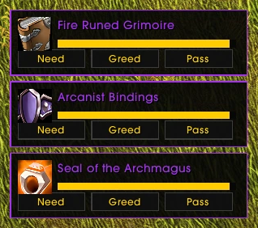

**Clean loot roll frames for WoW Forever.** See at a glance who rolled what, answer faster, and never lose a roll on a big drop. Lightweight, standalone, no other addon needed.

## What you get

- **Your own roll frames** in place of Blizzard's: item tooltip (Ctrl+click to preview, Shift+click to link in chat), quality colours, timer bar, and Need / Greed / Pass.
- **Live vote counters** on each button, with the list of players on hover (class coloured, with the roll once the game reveals it).
- **"Hasn't rolled yet"**: a small clock with the number of players still deciding. Hover for who.
- **Winner popup**: who won each roll and with what, and always your own roll. Hover a card for the item tooltip and every roll of the drop.
- **Big drops are safe**: extra rolls wait in a queue and appear as you answer, timers still running. Rolls in progress come back after a /reload.
- **Less chat spam**: the per-roll lines are filtered out, who won what stays visible.

## Two skins *(new)*

Pick the look of the roll frames in *Options → General*, it applies at once:

- **CleanLoot**: flat, dark and compact (the default).
- **Classic**: the game's own roll frame look, with the dialog border, the dice / coin / pass pictures as buttons, and the item in a frame in its quality colour.

Vote counters, the "hasn't rolled yet" clock, the watchlist, auto-roll and controller mode work the same in both.

## Loot sessions

For master looters: hand out what the boss dropped, **one item at a time**, with rolls everybody can follow.

- **Take all** gives you every master-loot item of the loot window to hand out later, and tells the group. `/cll session` lists what you can still trade (time left on bind-on-pickup items included).
- **Timed sessions**: each item is offered for 15 seconds (10 to 60 in the options). The group is told how to roll (`1-100=MS 1-99=OS 1-90=Other`) with a 3-2-1 countdown, and the rolls are read from the game's own `/roll` messages: **players without CleanLoot just type /roll**. MS beats OS beats Other, ties are re-rolled between the tied players only.
- **Players with CleanLoot** get a window with the item in play, the time left, everybody's rolls and buttons to roll or pass.
- **Identical items** are offered together (the best rolls win a copy each). A small icon per finished item lets you take an assignment back or give it by hand.
- **A disenchanter**: ask who can disenchant, designate one, and what nobody wants goes to him.
- **Handing over**: when a winner opens a trade with you, the items he won are already in the window. Six per trade, the next trade opens by itself.
- *Test it* runs a whole session with made-up players, sending nothing to the group.

## Loot record

A window of its own for `/loot`, in place of the game's Loot Rolls window. **Who won what, by instance, by boss, or all of it**, with every roll in the tooltip, shift-click to link an item, and a filter for what you won. CleanLoot keeps the record itself, so it survives groups and reloads: every roll the game decides, every item handed out by a master looter, every session award.

## Master loot

With a master looter the game names no winner. CleanLoot opens a **roll result window** for each item when the rolls end, for **everybody in the group**: every roll with the player's name, best first, ties flagged. The master looter **clicks a name** to give that player the item, and the group is told: `[CleanLoot] [item] given to Name for roll Greed 44`.

## Auto-roll

Stop clicking the same answer on the same items. **Nothing is automatic until you make a rule.**

- Always **Need**, **Greed** or **Pass** on an item: right-click the button on its roll frame (it turns green, right-click again to forget the rule), or add it in the options.
- Or one answer for every **green, blue, epic or legendary** item. An item rule wins over a quality rule.
- **Safe by design**: a rule only answers when the answer is possible. If the button is greyed out for you, or a bind-on-pickup prompt would need your confirmation, the roll stays yours. A chat line tells you what was answered, or why not.

## Watchlist

Keep a list of the items you are hunting. When one drops, its roll frame gets a **gently pulsing cyan outline**, and the **note** you wrote for it (*BiS for my mage*) shows on the frame and in the icon's tooltip.

- Add an item by shift-clicking it into the box, pasting its link, or typing its id. Or with `/cll watch [item] [note]`.
- It only draws the eye: nothing is answered for you. (That is auto-roll, and both can apply to the same item.)

## Options window

`/cll` opens CleanLoot's own window, with a tab for each part: **General**, **Controller mode**, **Auto-roll**, **Watchlist**, **Master loot**, **Disenchanter** and **Loot record**. It is not a modal game panel: your bags, the Dungeon Journal or the chat stay open beside it, so you can shift-click an item straight into its boxes. You can move it, Esc closes it, and it opens in combat. The minimap button's right-click opens it too.

## Controller mode *(off by default)*

Made for gamepads and keyboards: select a visible roll and answer Need / Greed / Pass with keys or controller buttons you set right in the options, or with slash commands (handy in macros or OPie). Optional inspection tooltip, with Pawn upgrade info when Pawn is installed.

## And also

- Roll frames and winner popup can be moved, scaled, stacked up or down, and locked. Ctrl+click an item in the loot record to see it on your character.
- Loot toast options (off by default): hide the "You won" banner, shrink it, or move it.
- Blizzard's own roll frames are hidden (an option brings them back).
- Minimap button: left-click for the loot record, right-click for the options.
- Built-in drop simulator (`/cll sim`) to try everything without a real drop.

## Commands

- `/cll`: open or close the options window
- `/loot`: the loot record, who won what
- `/cll session`: master looter, your tradable items and the loot session
- `/cll sim [n]`: simulate loot rolls to try the frames
- `/cll next`, `previous`, `inspect`, `need`, `greed`, `pass`: controller mode, for keys and macros
- `/cll debug on`: trace every roll in chat, to report a bug

## Reporting bugs

Forever is still in beta and its API changes. If something breaks after a client update, run `/cll debug on`, reproduce it, and share the chat lines with your client build, on [GitHub](https://github.com/hazaswow/CleanLoot/issues) or in the comments.

Source and releases: [https://github.com/hazaswow/CleanLoot](https://github.com/hazaswow/CleanLoot)

## Who makes this

I'm Hazas, and I stream WoW on Twitch, come say hi: [https://www.twitch.tv/hazaswow](https://www.twitch.tv/hazaswow)

If CleanLoot saves you some clicks and you'd like to help me pay my Claude subscription, there's a Ko-fi: [https://ko-fi.com/hazas](https://ko-fi.com/hazas)
